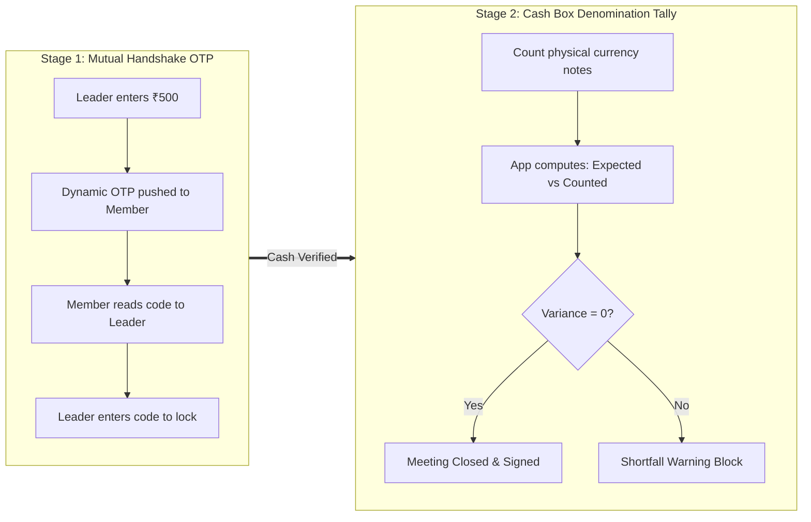
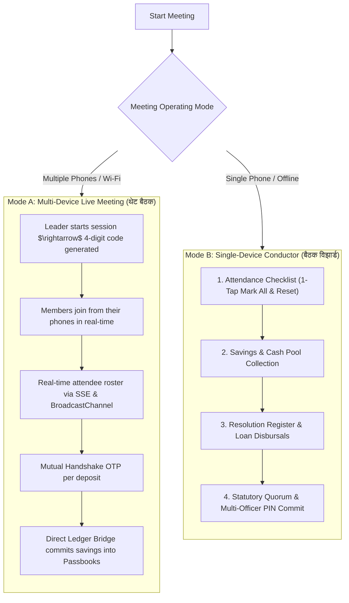
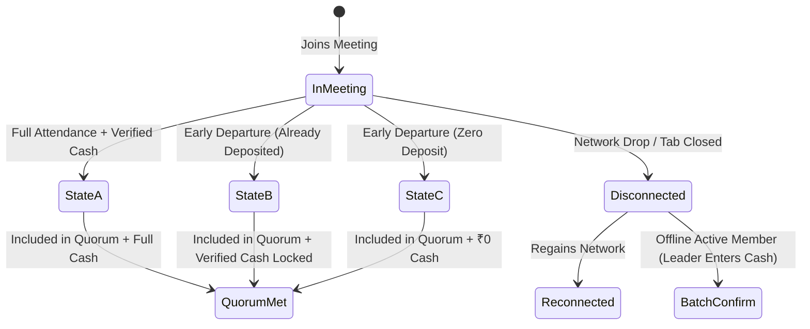
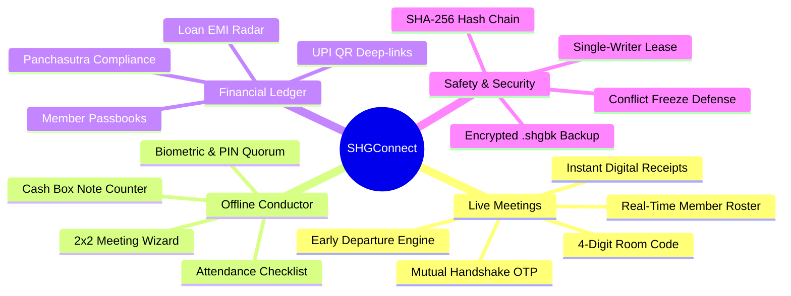
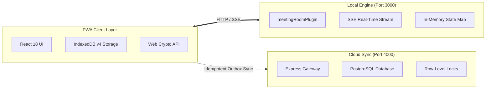

<div align="center">

# SHGCONNECT

### Local-First Microfinance OS & Cryptographic Ledger for Rural SHGs

[](https://www.typescriptlang.org/)
[](https://reactjs.org/)
[](https://vitejs.dev/)
[](https://tailwindcss.com/)
[](https://developer.mozilla.org/en-US/docs/Web/API/IndexedDB_API)
[](https://developer.mozilla.org/en-US/docs/Web/API/Web_Crypto_API)

[Live Demo](https://shg-connect-in.vercel.app/#)  •  [मराठी माहितीपत्रक](README.mr.md)  •  [Architecture](#6-technical-architecture)

</div>

---

## What is SHGConnect?

In rural India, 10 to 15 women form a Self-Help Group (बचत गट) to pool small monthly savings, collect loan repayments, issue emergency loans, and keep physical cash in a metal box. 

Traditionally, one person (secretary or animator) writes everything in handwritten paper registers. This leads to common problems:
- Calculation errors during long meetings.
- Lack of transparency (members often don't know their exact balance or interest paid).
- Torn, lost, or locked registers.
- Discrepancies between what was written in the book and what is physically in the cash box.
- Poor or zero internet connectivity in village meeting halls.

**SHGConnect** solves these problems directly. It is an installable web app (PWA) that works **100% offline** on entry-level Android smartphones. It can be used by a single leader on one phone, or connected across multiple members' phones during a live meeting using an instant **Handshake OTP** to verify every rupee before it is recorded.

---

## 1. 4-Tier Role-Based Dashboard Access

SHGConnect structures access across 4 distinct functional tiers arranged side-by-side to guarantee strict segregation of duties:

```mermaid
flowchart LR
    subgraph Col1["Tier 1: Member (सभासद)"]
        direction TB
        M1["Personal Passbook"]
        M2["Live Handshake OTP"]
        M3["Dynamic UPI QR"]
        M4["EMI Repayment Radar"]
    end

    subgraph Col2["Tier 2: Lead (गट प्रमुख)"]
        direction TB
        L1["Host Live Room"]
        L2["4-Step Meeting Conductor"]
        L3["Cash Box Note Counter"]
        L4["Single-Writer Master Lease"]
    end

    subgraph Col3["Tier 3: Animator (अधिकारी)"]
        direction TB
        A1["Multi-SHG Portfolio"]
        A2["Attendance Health Radar"]
        A3["Offline .shgbk Backups"]
        A4["Member Onboarding"]
    end

    subgraph Col4["Tier 4: Auditor (लेखापरीक्षक)"]
        direction TB
        U1["SHA-256 Chain Verifier"]
        U2["Merkle Root Audit"]
        U3["Panchasutra Score 0-100"]
        U4["One-Click Compliance Export"]
    end

    Col1 --- Col2 --- Col3 --- Col4
```



### Role Breakdown

| Tier & Role | Core View | Primary Capabilities |
| :--- | :--- | :--- |
| **Tier 1: Member** | `MemberDashboard.tsx` | **Read-Only Passbook & Meeting Client.** Individual savings balances, EMI schedules, 4-digit room join, dynamic departure modal, and live cash OTP verification. |
| **Tier 2: Lead** | `OfficeBearerDashboard.tsx` | **Operational Meeting Console.** Real-time room broadcast, single-writer ledger write lease, physical note denomination counter, and dual PIN sign-off. |
| **Tier 3: Animator** | `AnimatorDashboard.tsx` | **Village Cluster Oversight.** Cross-group portfolio monitoring (5–20 SHGs), multi-group meeting orchestration, `.shgbk` device backups, and health grading. |
| **Tier 4: Auditor** | `AuditorDashboard.tsx` | **Institutional Compliance.** Read-only forensic ledger inspection, SHA-256 chain verification, and automated NABARD Panchasutra grading. |

---

## 2. How Physical Cash is Verified

Software cannot roll back rupee notes once handed out of a cash box. SHGConnect uses a horizontal two-stage verification pipeline to reconcile physical cash against digital records:



### 1. The Mutual Handshake OTP (Preventing Typing Errors & Disputes)
- When the leader enters an amount (e.g. ₹500) and hits Save, the app **does not** immediately save it.
- A dynamic 4-digit OTP is pushed directly to that specific member's phone over the local connection.
- The member's phone displays:
  > **बचत रक्कम पडताळणी (Savings Verification)**  
  > प्रमुखांनी तुमची बचत नोंदवली: **₹५००**  
  > रक्कम बरोबर असल्यास हा कोड प्रमुखाला सांगा: **`[ 7 7 4 2 ]`**
- The member physically hands the cash and reads out the code. Once typed by the leader, the transaction is permanently locked.

### 2. Cash Box Note Counter (Preventing Physical Cash Loss)
At the end of the meeting, the secretary enters the actual count of paper notes:
- Counts ₹500, ₹200, ₹100, ₹50, ₹20, ₹10 notes and coins.
- Formula enforced:
  $$\text{Expected Total} = \text{Opening Balance} + \text{Savings Collected} + \text{Loan EMIs Collected} - \text{Loans Disbursed}$$
- If physical cash is ₹11,200 but the ledger says ₹11,400, a warning banner highlights a **₹200 shortfall** before anyone can exit.

---

## 3. Meeting Operational Modes & Dynamic Protocols

SHGConnect accommodates both high-tech villages where members have smartphones and remote hamlets where only the leader carries a device.



### Mode A: Multi-Device Live Meeting (`LeadLiveMeeting` & `MemberLiveMeeting`)
- **Transport Layer**: Powered by Server-Sent Events (SSE) with an autonomous fallback to local `BroadcastChannel` and `localStorage` for 100% offline local networks.
- **Dynamic Heartbeat**: 15-second keep-alive pings monitor connection health. If a phone sleeps, the client auto-reconnects with a 1.5s backoff.
- **Direct Ledger Commit Bridge**: When the leader completes the meeting, all verified deposits and attendance records automatically generate SHA-256 chained transaction blocks, update individual member passbooks, adjust group balances, and log outbox operations.

### Mode B: Single-Device Meeting Conductor (`MeetingWizard`)
- **2-Row × 2-Column Responsive Layout**: Optimized for mobile screens to eliminate cluttered horizontal scrolling.
- **Attendance Checklist**: Quick presets with standard vector checkmarks, real-time presence tally, and instant reset.
- **Dual Officer PIN Signatures**: Cryptographically proves that at least two designated officers (President, Secretary, or Treasurer) physically validated the cash and signed the ledger before sealing.

---

## 4. Member Lifecycle, Early Departures & Edge-Case Safeguards

In rural village settings, meetings frequently encounter interruptions: infants crying, cattle feeding schedules, agricultural urgencies, or drained phone batteries. SHGConnect establishes strict accounting invariants for every departure scenario:



### The 3 Canonical Member Departure States

| State | Scenario | Attendance Quorum Status | Financial Ledger Status | UI Representation |
| :--- | :--- | :--- | :--- | :--- |
| **State A** | **Full Meeting Attendance** | Counted as present | Full verified deposit added to pool | Green checkmark, `Online` pill |
| **State B** | **Early Departure (After Depositing)** | Preserved for statutory quorum | Verified deposit locked permanently; unaffected by departure | `[Left Early • ₹X Verified]` |
| **State C** | **Early Departure (No Deposit)** | Preserved for statutory quorum | Strictly **₹0** (Zero deposit commitment) | `[Left Early]` + `[No Deposit (₹0)]` |

### Detailed Edge-Case Protocols

#### 1. Early Departure with No Deposit (State C)
- If a member must leave before depositing, they tap **`बैठक सोडा (Leave Meeting)`**.
- A modal requires selecting an inevitable rural reason:
  - 👶 *बालक रडत आहे (Infant crying)*
  - 🐄 *जनावरांची काळजी (Cattle / livestock care)*
  - 🪫 *फोन बॅटरी संपत आहे (Phone battery depleted)*
  - 🌾 *शेती / घरगुती तातडीचे काम (Urgent agricultural chores)*
  - 📝 *इतर काम (Other urgent work)*
- **Quorum Preservation**: Because the member was physically present, their attendance is **preserved** to satisfy statutory quorum requirements (minimum 50% attendance rule).
- **Zero Phantom Money**: Savings is recorded strictly as **₹0**. No cash is added to the pool.

#### 2. Accidental Tab Close, App Kill, or Browser Back Navigation
- Handled by synchronized `beforeunload`, `pagehide`, and `popstate` listeners in `MemberLiveMeeting.tsx`.
- Dispatches an asynchronous `navigator.sendBeacon` request directly to `/api/meeting/:code/leave`.
- Any pending handshake OTP is instantly aborted (`savings_cancelled`).
- Prevents hanging states: unverified savings automatically defaults to **₹0**, protecting the cash ledger from phantom entries.

#### 3. Network Disconnects vs. Batch Confirm Safeguards
- **Strict Activation Constraint**: The **Batch Confirm (`सर्व मंजूर करा`)** button is **strictly activated only if an active member is disconnected** due to poor village cellular coverage. If all members are connected, the button remains disabled.
- **Exclusion of Departed Members**: Members who have checked out or left early (`leftEarly: true`) are **strictly excluded** from batch confirmation.
- **Zero Phantom Default Guarantee**:
  - The system **never invents default money** (all legacy `|| 250` or `|| 300` defaults have been completely eradicated).
  - The leader must explicitly enter the physical cash amount received. If left blank, the app blocks execution and warns the leader: *"कृपया डिस्कनेक्ट सदस्याची रक्कम टाका (Please enter savings amount)"*.

---

## 5. Complete Feature Catalog



---

## 6. Technical Architecture

A local-first architecture engineered for zero-connectivity environments with optional upstream reconciliation:



- **Offline-First PWA:** Uses Service Workers with 10MB asset caching (`workbox`). Loads instantly without network.
- **Persistent Storage:** Requests `navigator.storage.persist()` on boot so Android Chrome never clears group records under low storage.
- **Audio Fallback Engine:** If an Android Go phone lacks Devanagari text-to-speech voice packs, the app uses the Web Audio API to synthesize melodic chimes (cash deposit chime, loan approval fanfare, warning buzz).
- **Express vs. Vite Middleware Parity:** All 12 meeting endpoints (room management, handshake OTPs, early departure, batch confirmation, and SSE heartbeats) run identically in local Vite dev server and production Express servers.

---

## 7. Verification & Test Results

The codebase includes an automated invariant verification harness:

```text
[PASS] Invariant 1 : Local Commit vs Remote Sync Distinction
[PASS] Invariant 2 : Idempotency Key Preservation (Cached ACK on duplicate push)
[PASS] Invariant 3 : Monotonic Sequence Counter Independence
[PASS] Invariant 4 : OCC Scope Limits (Entity version validation)
[PASS] Invariant 5 : Protected Entity Deferral (deferred_remote_ops)
[PASS] Invariant 6 : Durable lastServerSeq Cursor Advancement
[PASS] Invariant 7 : Multi-Tenant shgId Isolation
[PASS] Invariant 8 : Stale Crash Recovery (>60s timeout)
[PASS] Invariant 9 : Conflict Resolution: ACCEPT_REMOTE
[PASS] Invariant 10: Conflict Resolution: KEEP_LOCAL
[PASS] Invariant 11: Conflict Resolution: RETRY_MERGED
[PASS] Invariant 12: Pull stream opId sequence consumption
[PASS] Invariant 13: Network OFFLINE State Handling
[PASS] Invariant 14: Outbox Queue Ordering & HLC Timestamps
[PASS] Invariant 15: Audit Envelope Logging during Remote Pull Apply
[PASS] Invariant 16: Derived SYNCED Indicator Calculation (ONLINE + IDLE + pending=0)

Valid Chain Verification : PASS (All SHA-256 blocks valid, Merkle root intact)
Tamper Simulation Attack : PASS (Altering block 0 amount from ₹500 to ₹50,000 
                                 immediately detected at index 0)
Server Vitest Suite      : PASS (13/13 tests across sync.integration & otp.integration)
```

---

## 8. Getting Started & Testing

### Prerequisites
- Node.js (version 18 or newer)
- npm

### Installation & Build

```bash
# Clone the repository
git clone https://github.com/AayushRahate07/shg-connect.git
cd shgconnect/shgconnect-pwa

# Install dependencies
npm install

# Build production assets (TypeScript check + Vite bundle)
npm run build

# Start server bound to all network interfaces
npm run dev -- --host 0.0.0.0 --port 3000
```

---

## How to Test Live Multi-Device Meeting (3 Phones on Wi-Fi)

1. Find your host computer's local Wi-Fi IP address (e.g. `192.168.1.15` or `10.225.150.173`).
2. Connect your computer and phones to the same Wi-Fi router or mobile hotspot.
3. Open `http://<YOUR_IP>:3000` in the browser on all 3 devices.

### Step-by-Step Test:
1. **On Phone 1 (Leader):**
   - Log in as **गट प्रमुख (SHG Lead)**.
   - Click **`📡 थेट बैठक सुरू करा (Start Live Meeting)`**.
   - Note the **4-digit room code** on the screen (e.g. `9757`).
2. **On Phones 2 & 3 (Members):**
   - Log in as **सभासद (Member)** (e.g. Sunita / Anita).
   - Tap the **बैठका (Meetings)** tab at the bottom $\rightarrow$ click **`📡 थेट बैठक कक्ष • बैठकीत सामील व्हा`**.
   - Enter `9757`.
3. **Verify Attendance & Physical Cash Handshake:**
   - Phone 1 immediately shows both members appear with green **Online** badges.
   - On Phone 1, enter `500` for Phone 2 and tap **`नोंदवा (Save)`**.
   - Phone 2 chimes and displays the **Mutual Handshake Sheet**:
     $$\text{₹५०० बचत} \quad\longrightarrow\quad \text{पडताळणी कोड: } [\mathbf{7742}]$$
   - Phone 1 prompts for the code. Type `7742` and hit confirm.
   - Both phones play a celebratory stamp sound, Phone 2 receives a **Verified ✅** badge, and the meeting cash box updates in real time.
4. **Test Member Leaving Midway (Early Departure):**
   - On Phone 3 (Anita), tap **`बैठक सोडा (Leave Meeting)`**.
   - Select reason *"बालक रडत आहे (Infant crying)"* and confirm.
   - Phone 1 immediately shows Anita updated to **`लवकर बाहेर पडली • बिनबचत (₹०)`**.
   - Notice that **Batch Confirm** remains disabled, and Anita's deposit remains strictly ₹0 with no phantom cash added to the pool.
5. **Complete Meeting & Verify Passbook:**
   - On Phone 1, tap **`बैठक पूर्ण करा (Complete Meeting)`**.
   - Check statutory quorum calculation (Anita is credited for presence, preserving quorum).
   - Confirm and seal: verified savings are immediately committed to member passbooks and the group's cryptographic ledger.

---

<div align="center">

### SHGCONNECT | AAYUSH RAHATE

</div>
