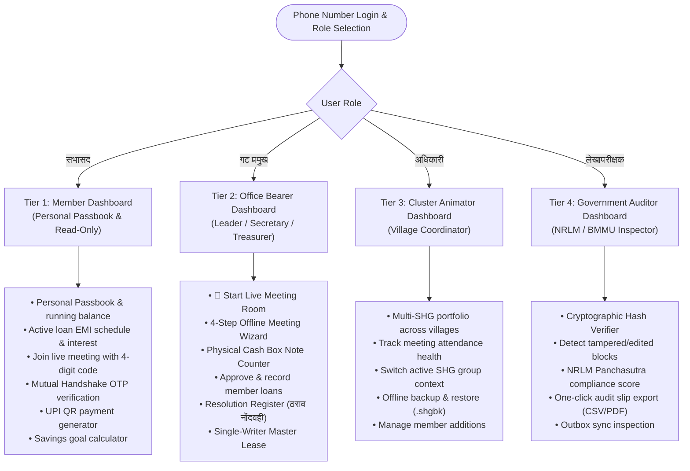
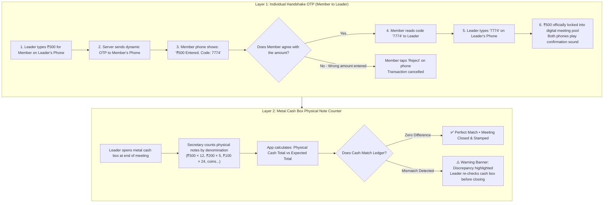
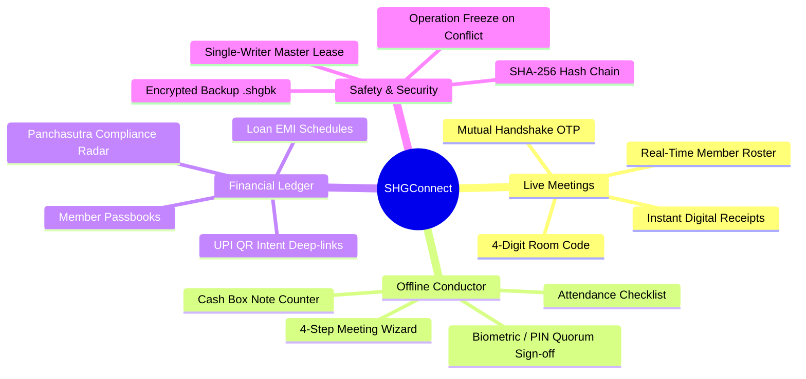
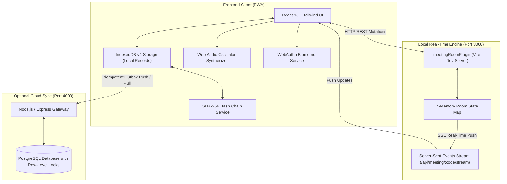

<div align="center">

# SHGCONNECT

### Local-First Microfinance OS & Cryptographic Ledger for Rural SHGs

[](https://react.dev/)
[](https://www.typescriptlang.org/)
[](https://developer.mozilla.org/en-US/docs/Web/API/IndexedDB_API)
[](https://developer.mozilla.org/en-US/docs/Web/API/Web_Crypto_API)
[](https://www.postgresql.org/)
[](https://nodejs.org/)
[](LICENSE)

[Live Demo](https://shg-connect-nine.vercel.app/) • [Architecture](#4-technical-architecture) • [Testing Guide](#how-to-test-live-multi-device-meeting-3-phones-on-wi-fi)

---

</div>

## What is SHGConnect?

In rural India, 10 to 15 women form a Self-Help Group (बचत गट) to pool small monthly savings, collect loan repayments, issue emergency loans, and keep physical cash in a metal box. 

Traditionally, one person (secretary or animator) writes everything in handwritten paper registers. This leads to common problems:
- Calculation errors during long meetings.
- Lack of transparency (members often don't know their exact balance or interest paid).
- Torn, lost, or locked registers.
- Discrepancies between what was written in the book and what is physically in the cash box.
- Poor or zero internet connectivity in village meeting halls.

**SHGConnect** solves these problems directly. It is an installable web app (PWA) that works **100% offline** on entry-level Android smartphones. It can be used by a single leader on one phone, or connected across multiple members' phones during a live meeting using an instant **Handshake OTP** to verify every rupee before it is recorded.

---

## 1. 4-Tier Role-Based Dashboard Access

SHGConnect structures access into 4 distinct tiers so members see their personal finances, leaders run meetings, animators oversee clusters, and auditors inspect books without accidental data changes:



### Detailed Breakdown of the 4 Tiers

| Tier | Role Title | Primary Screen | Permissions & Capabilities |
| :--- | :--- | :--- | :--- |
| **Tier 1** | **Member (सभासद)** | `MemberDashboard.tsx` | **Read-Only Personal Records & Meeting Participation.**<br/>• Views individual savings deposits, loan balances, next EMI due date.<br/>• Joins live meeting by entering a 4-digit room code.<br/>• Receives real-time Handshake OTP to verify physical cash handed to the leader.<br/>• Generates UPI deep-link QR codes for cashless payments.<br/>• Checks the group's overall Panchasutra health score. |
| **Tier 2** | **SHG Lead (गट प्रमुख)** | `OfficeBearerDashboard.tsx` | **Full Meeting & Financial Operations.**<br/>• Launches live multi-device meetings with 4-digit room codes.<br/>• Inputs savings and enters member handshake codes to lock transactions.<br/>• Runs traditional 4-step offline meeting wizard when members don't have phones.<br/>• Uses the physical cash box counter to balance rupee notes.<br/>• Records group resolutions (ठराव) approved during the meeting. |
| **Tier 3** | **Cluster Animator (अधिकारी)** | `AnimatorDashboard.tsx` | **Multi-Village Cluster Coordination.**<br/>• Monitors 5 to 20 SHGs across different villages from a single phone.<br/>• Tracks which groups are holding regular meetings and meeting NRLM standards.<br/>• Manages offline data backup files (`.shgbk`) on device storage.<br/>• Registers new members and handles group onboarding. |
| **Tier 4** | **Auditor (लेखापरीक्षक)** | `AuditorDashboard.tsx` | **Government / Bank Inspection & Verification.**<br/>• Inspects complete transaction ledgers without edit permissions.<br/>• Runs SHA-256 hash checks to ensure no historical payment was altered.<br/>• Checks the 5 NRLM Panchasutra metrics before bank loan linkage.<br/>• Exports compliance and financial reports. |

---

## 2. How Physical Cash is Verified

The hardest problem in rural microfinance is that **software cannot roll back rupee notes once handed out of a metal box**. SHGConnect uses a two-layer verification system to guarantee that digital numbers match physical cash:



### 1. The Mutual Handshake OTP (Preventing Typing Errors & Disputes)
- When the leader enters an amount (e.g. ₹500) and hits Save, the app **does not** immediately save it.
- A dynamic 4-digit OTP is pushed directly to that specific member's phone over the local connection.
- The member's phone displays:
  > **बचत रक्कम पडताळणी (Savings Verification)**  
  > प्रमुखांनी तुमची बचत नोंदवली: **₹५००**  
  > रक्कम बरोबर असल्यास हा कोड प्रमुखाला सांगा: **`[ 7 7 7 4 ]`**
- The member physically hands the cash and reads out the code.
- Once the leader types `7774`, the transaction is locked and verified with a stamp sound on both devices.
- If the leader accidentally typed ₹5,000 instead of ₹500, the member taps **"रक्कम चुकीची आहे (Reject)"**, and nothing is saved.

### 2. Physical Cash Box Note Counter (Preventing Physical Missing Cash)
At the end of the meeting, the secretary enters the actual count of paper notes:
- Number of ₹500, ₹200, ₹100, ₹50, ₹20, ₹10 notes and coins.
- The app calculates:
  $$\text{Expected Total} = \text{Opening Balance} + \text{Savings Collected} + \text{Loan EMIs Collected} - \text{Loans Disbursed}$$
- If physical cash is ₹11,200 but the ledger says ₹11,400, a clear warning banner shows a **₹200 shortfall** before anyone leaves the meeting room.

---

## 3. Complete Feature Catalog



### 1. Live Multi-Device Meeting Room
- Runs on local Wi-Fi or mobile data via lightweight Server-Sent Events (SSE).
- Leader creates a room with one tap and shares a 4-digit code (e.g., `9757`).
- Members join from their own phones without complicated passwords.
- Real-time roster shows who is present with a green indicator.

### 2. 4-Step Offline Meeting Wizard (Single-Phone Mode)
When only one phone is available in the meeting, the leader uses the guided wizard:
- **Step 1 (हजेरी / Attendance):** One-tap present/absent checklist.
- **Step 2 (बचत व कर्ज / Savings & Loans):** Records monthly savings per member and approves new internal loan requests.
- **Step 3 (रोकड पडताळणी / Cash Box):** Denomination counter for physical currency.
- **Step 4 (स्वाक्षरी व शिक्कामोर्तब / Quorum Sign-off):** Both President and Secretary sign off using device fingerprint biometrics or secure PINs.

### 3. Loan Eligibility & EMI Calculator
- Sliders calculate monthly EMI schedules for internal loans (₹1,000 to ₹50,000).
- Supports standard SHG monthly reducing balance interest (typically 1% to 2% per month).
- Displays principal vs. interest breakdown for complete transparency.

### 4. Meeting Resolution Book (ठराव नोंदवही)
- Records formal resolutions passed by group consensus (e.g. approving an emergency loan for cattle feed or setting the next meeting date).
- Saved in regional Marathi/Hindi formats aligned with government inspection registers.

### 5. NPCI-Compliant UPI QR Intent Generator
- Members who prefer paying digitally can generate a standard UPI QR code directly inside the app:
  `upi://pay?pa=shgaccount@bank&pn=SavitriSHG&am=500&tn=MonthlySavings`
- Can be scanned by PhonePe, Google Pay, or Paytm.

### 6. Tamper-Check Hash Chain (Ledger Verifier)
- Every transaction links cryptographically to the previous transaction using SHA-256.
- If an unauthorized person modifies browser storage to change past payment records, the chain breaks.
- The auditor tool flags the exact corrupted block index immediately.

### 7. Single-Writer Master Lease (Double-Spend Protection)
- Prevents two officers on separate phones from disbursing cash against the same metal cash box while offline.
- Only the designated Master Device (Secretary's phone) can approve loan disbursals and cash withdrawals while disconnected.

### 8. Offline Encrypted Backup & Restore (`.shgbk`)
- One-click export of complete group records into an encrypted file on the phone.
- Can be shared via WhatsApp or saved to an SD card for offsite safety.
- Built-in fork protection: refuses to restore an older, out-of-date backup over newer data.

---

## 4. Technical Architecture



- **Offline-First PWA:** Uses Service Workers with asset caching (`workbox`). Loads instantly without network.
- **Persistent Storage:** Requests `navigator.storage.persist()` on boot so Android Chrome never clears group records under low storage.
- **Audio Fallback Engine:** If an Android Go phone lacks Devanagari text-to-speech voice packs, the app uses the Web Audio API to synthesize melodic chimes (cash deposit chime, loan approval fanfare, warning buzz).

---

## 5. Verification & Test Results

The codebase includes an automated invariant verification harness:

```text
[PASS] Invariant 1 : Local Commit vs Remote Sync Distinction
[PASS] Invariant 2 : Idempotency Key Preservation (Cached ACK on duplicate push)
[PASS] Invariant 3 : Monotonic Sequence Counter Independence
[PASS] Invariant 4 : OCC Scope Limits (Entity version validation)
[PASS] Invariant 5 : Protected Entity Deferral (deferred_remote_ops)
[PASS] Invariant 6 : Durable lastServerSeq Cursor Advancement
[PASS] Invariant 7 : Multi-Tenant shgId Isolation
[PASS] Invariant 8 : Stale Crash Recovery (>60s timeout)
[PASS] Invariant 9 : Conflict Resolution: ACCEPT_REMOTE
[PASS] Invariant 10: Conflict Resolution: KEEP_LOCAL
[PASS] Invariant 11: Conflict Resolution: RETRY_MERGED
[PASS] Invariant 12: Pull stream opId sequence consumption
[PASS] Invariant 13: Network OFFLINE State Handling
[PASS] Invariant 14: Outbox Queue Ordering & HLC Timestamps
[PASS] Invariant 15: Audit Envelope Logging during Remote Pull Apply
[PASS] Invariant 16: Derived SYNCED Indicator Calculation (ONLINE + IDLE + pending=0)

Valid Chain Verification : PASS (All SHA-256 blocks valid, Merkle root intact)
Tamper Simulation Attack : PASS (Altering block 0 amount from ₹500 to ₹50,000 
                                 immediately detected at index 0)
```

---

## 6. Getting Started & Testing

### Prerequisites
- Node.js (version 18 or newer)
- npm

### Installation & Build

```bash
# Clone the repository
git clone https://github.com/your-username/shgconnect.git
cd shgconnect/shgconnect-pwa

# Install dependencies
npm install

# Build production assets (TypeScript check + Vite bundle)
npm run build

# Start server bound to all network interfaces
npm run dev -- --host 0.0.0.0 --port 3000
```

---

## How to Test Live Multi-Device Meeting (3 Phones on Wi-Fi)

1. Find your host computer's local Wi-Fi IP address (e.g. `192.168.1.15` or `10.225.150.173`).
2. Connect your computer and phones to the same Wi-Fi router or mobile hotspot.
3. Open `http://<YOUR_IP>:3000` in the browser on all 3 devices.

### Step-by-Step Test:
1. **On Phone 1 (Leader):**
   - Log in as **गट प्रमुख (SHG Lead)**.
   - Click **`📡 थेट बैठक सुरू करा (Start Live Meeting)`**.
   - Note the **4-digit room code** on the screen (e.g. `9757`).
2. **On Phones 2 & 3 (Members):**
   - Log in as **सभासद (Member)** (e.g. Sunita / Anita).
   - Tap the **बैठका (Meetings)** tab at the bottom $\rightarrow$ click **`📡 थेट बैठक कक्ष • बैठकीत सामील व्हा`**.
   - Enter `9757`.
3. **Verify Attendance & Physical Cash Handshake:**
   - Phone 1 immediately shows both members appear with green **Online** badges.
   - On Phone 1, enter `500` for Phone 2 and tap **`नोंदवा (Save)`**.
   - Phone 2 chimes and displays the **Mutual Handshake Sheet**:
     $$\text{₹५०० बचत} \quad\longrightarrow\quad \text{पडताळणी कोड: } [\mathbf{7774}]$$
   - Phone 1 prompts for the code. Type `7774` and hit confirm.
   - Both phones play a celebratory stamp sound, Phone 2 receives a **Verified ✅** badge, and the meeting cash box updates in real time.
