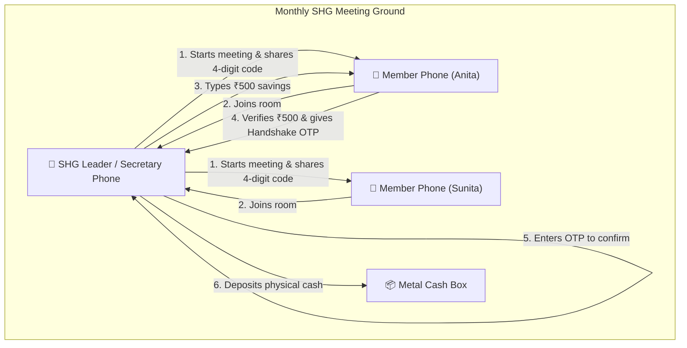
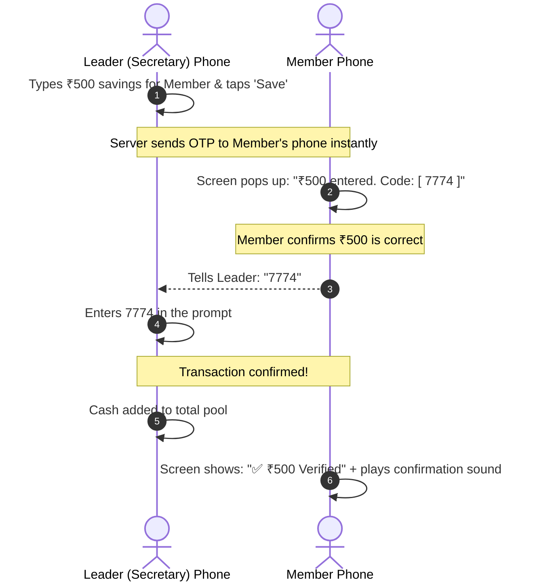
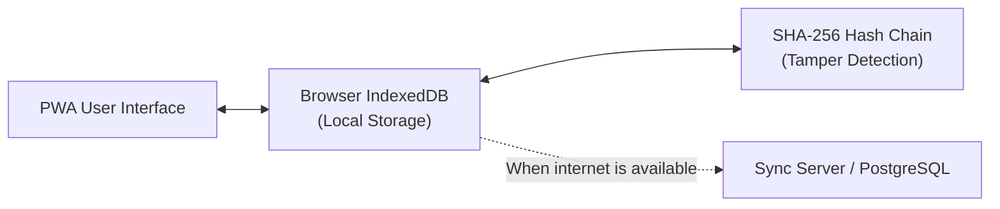

```markdown
# SHGConnect (स्वयंसहाय्यता गट कनेक्ट)
A practical, offline-first meeting and bookkeeping web application built for rural Indian Self-Help Groups (महिला बचत गट).

---

## What is SHGConnect?

In a typical Indian village Self-Help Group (SHG), 10 to 15 women meet once a month to pool their monthly savings (usually ₹100 to ₹500 each), collect loan repayments, issue small emergency loans, and reconcile cash in a metal box. 

Most groups manage this entirely in handwritten paper registers. Common problems include:
- Calculation errors during long meetings.
- Disputes over who paid how much.
- Registers getting damaged, misplaced, or held exclusively by one person.
- Spotty or zero mobile network during meetings in village halls or member homes.

**SHGConnect** is built to solve these exact problems. It runs in the phone's browser as an installable app (PWA), works completely offline, and lets members and leaders track their savings, loans, and meeting records with clear confirmation on their own phones.

---

## How It Works

SHGConnect can be used in two ways:
1. **Single-Device Mode (Offline):** The secretary holds one phone, enters attendance, records savings and loans, counts notes in the cash box, and closes the meeting. Everything saves locally to the phone's browser storage (IndexedDB).
2. **Multi-Device Live Meeting (Wi-Fi or Mobile Data):** If other members have smartphones, they can join the meeting live using a 4-digit code. When the leader records their savings, the member verifies the amount on their own screen before the transaction is saved.



---

## Key Features

### 1. Live Multi-Device Meeting & Mutual Handshake OTP
To prevent mistakes (like the leader accidentally typing ₹5,000 instead of ₹500, or a member claiming they paid when they didn't), SHGConnect uses a simple two-step handshake:



- If the amount is wrong, the member can tap **"रक्कम चुकीची आहे (Reject)"** right on their phone.
- The money is only marked saved once the leader enters the code from the member's screen.

---

### 2. Physical Cash Box Reconciliation
At the end of every meeting, the physical cash collected must match the ledger. SHGConnect includes a dedicated note counter:
- Secretary enters the count for ₹500, ₹200, ₹100, ₹50, ₹20, ₹10 notes and coins.
- The app automatically totals the physical cash and compares it with:
  $$\text{Expected Total} = \text{Total Savings Collected} + \text{Loan EMIs Collected} - \text{Loans Disbursed}$$
- Highlights differences immediately before the meeting ends.

---

### 3. Offline-First Architecture
The app runs completely without internet during meetings:
- **Local Storage:** All members, transactions, loans, and meeting records are stored in IndexedDB inside the browser.
- **Offline Sign-off:** Officers can verify meeting sign-offs using their device screen lock or fingerprint (via WebAuthn) without needing an active internet connection.
- **Audio Cues:** Uses the browser's Web Audio synthesizer to play clear stamp sounds and chimes when money is recorded, even if an entry-level Android phone lacks Marathi text-to-speech files.



---

### 4. Simple Tamper-Check (Hash Chain)
To prevent records from being altered behind closed doors:
- Every transaction is hashed with SHA-256 along with the hash of the previous transaction.
- If someone edits an old payment (e.g., changes ₹500 to ₹5,000 in browser storage), the hash chain breaks.
- The built-in **Ledger Verifier** flags the exact transaction number that was altered.

---

### 5. 4 Simple Roles

| Role | What They See | What They Can Do |
| :--- | :--- | :--- |
| **Member (सभासद)** | Personal passbook, savings total, active loan balance, EMI dates. | View records, join live meetings using a 4-digit code, confirm savings with OTP. |
| **SHG Lead (गट प्रमुख)** | Full group dashboard, member list, cash box summary. | Start live meetings, run the 4-step meeting wizard, record savings, disburse loans. |
| **Animator (अधिकारी)** | Multi-group overview across several villages. | View health scores, track meeting schedules across groups, assist with setup. |
| **Auditor (लेखापरीक्षक)** | Complete transaction logs, compliance checklists. | Check ledger integrity, verify hash chains, export records. |

---

### 6. DAY-NRLM Panchasutra Compliance
The app tracks the 5 standard rules (पंचसूत्री) mandated by the National Rural Livelihoods Mission:
1. **नियमित बैठक (Regular Meetings):** Tracks meeting dates and attendance.
2. **नियमित बचत (Regular Savings):** Records monthly deposits per member.
3. **नियमित अंतर्गत कर्ज (Internal Lending):** Tracks loans given from group funds.
4. **नियमित परतफेड (Timely Repayment):** Tracks monthly principal and interest returns.
5. **अद्ययावत हिशोब (Up-to-Date Books):** Automatic passbooks and note reconciliation.

---

## Tech Stack

- **Frontend:** React 18, TypeScript, Tailwind CSS, Lucide Icons.
- **Build & Dev Tool:** Vite 6 with `vite-plugin-pwa` (offline service worker).
- **Client Storage:** IndexedDB (v4).
- **Real-Time Communication:** Server-Sent Events (SSE) via Vite dev server plugin (`/api/meeting/*`).
- **Cryptography:** Native Web Crypto API with fallback to `js-sha256`.
- **Audio:** Native Web Audio API (transient click & melodic chimes) + Web Speech API for Marathi/Hindi readouts.

---

## Project Structure

```text
shgconnect/
├── shgconnect-pwa/
│   ├── src/
│   │   ├── components/
│   │   │   ├── auth/            # Viewport-locked login screen
│   │   │   ├── meeting/         # Live multi-device meeting components
│   │   │   │   ├── LeadLiveMeeting.tsx    # Leader room & OTP verification dialog
│   │   │   │   └── MemberLiveMeeting.tsx  # Member view & OTP display sheet
│   │   │   ├── member/          # Passbook, savings, and loan views
│   │   │   ├── panchasutra/     # 5-Sutra compliance visualizer
│   │   │   ├── CashBoxReconciliation.tsx  # Note counter (₹500, ₹200, etc.)
│   │   │   ├── LedgerVerifier.tsx         # Tamper check tool
│   │   │   └── MeetingWizard.tsx          # 4-step offline meeting flow
│   │   ├── pages/               # Member, Lead, Animator, and Auditor dashboards
│   │   ├── services/            # IndexedDB, hash chain, live meeting API, audio
│   │   ├── types/               # TypeScript interfaces
│   │   └── App.tsx              # Role routing & navigation
│   ├── vite.config.ts           # Dev server config & meeting room broker
│   └── package.json
├── CHANGELOG.md                 # Version history
└── IMPLEMENTATION.txt           # Detailed implementation notes
```

---

## Getting Started

### Prerequisites
- Node.js (version 18 or newer)
- npm

### Installation & Run

1. Clone the repository:
   ```bash
   git clone https://github.com/your-username/shgconnect.git
   cd shgconnect/shgconnect-pwa
   ```

2. Install dependencies:
   ```bash
   npm install
   ```

3. Build the application (checks TypeScript and bundles PWA):
   ```bash
   npm run build
   ```

4. Start the server (accessible on local network):
   ```bash
   npm run dev -- --host 0.0.0.0 --port 3000
   ```

---

## How to Test with 2 or 3 Phones on the Same Wi-Fi

1. Find your computer's local IP address (e.g. `192.168.1.15` or `10.225.150.173`).
2. Make sure your computer and phones are connected to the same Wi-Fi network.
3. Open `http://<YOUR_COMPUTER_IP>:3000` in the mobile browsers.

### Testing the Meeting Flow:
1. **On Phone 1 (Leader):**
   - Select **गट प्रमुख (SHG Lead)** and log in.
   - Tap **`📡 थेट बैठक सुरू करा (Start Live Meeting)`**.
   - Note the **4-digit code** shown on screen (e.g. `4821`).
2. **On Phone 2 (Member):**
   - Select **सभासद (Member)** and log in.
   - Tap the **बैठका (Meetings)** tab at the bottom $\rightarrow$ click **`बैठकीत सामील व्हा (Join Meeting)`**.
   - Enter `4821`.
3. **Verify Attendance & Savings:**
   - Phone 1 immediately shows Phone 2 as joined.
   - On Phone 1, enter `500` for the member and tap **`नोंदवा (Save)`**.
   - Phone 2 will chime and show a sheet: **`₹500 बचत • कोड: [ 7774 ]`**.
   - Type `7774` on Phone 1 and hit confirm.
   - Both screens update to **`Verified ✅`** and add ₹500 to the total meeting collection.
```
